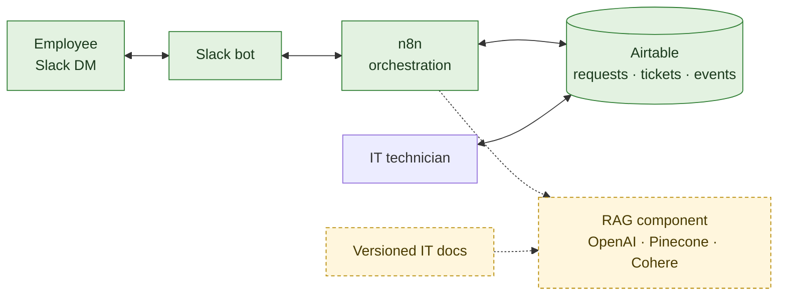

# AI-Powered IT Service Desk

An employee IT support flow on Slack, n8n and Airtable: every request is registered and traceable, routine issues can be answered from approved documentation by a RAG assistant, and a human technician is always one confirmed step away.

> **Status: work in progress.** Request intake and ticket creation are built and tested in isolation. The AI answer path, button interactions and timeouts are designed but not yet built. See [Project status](#project-status).

This is a portfolio prototype for a **simulated** company, not a production service. No business outcomes are claimed.

## The problem

The scenario assumes a company of 150 employees with a three-person IT team handling about 100 requests a week through Slack DMs and email. Technicians log requests by hand, requests arriving through different channels are documented inconsistently, and recurring questions consume time that self-service could absorb. These figures are assumptions for the case study ([business case](docs/01_business_case.md)).

## The approach: three responsibilities, kept separate

| Responsibility | Handled by | Why it sits there |
|---|---|---|
| Registering requests, routing, state changes, ticketing, retries | **Deterministic automation (n8n)** | These must be predictable, idempotent and auditable. |
| Finding approved procedures and drafting one answer with sources | **Generative AI (RAG)** | Useful for recurring questions; risky if it makes decisions. |
| Choosing AI or a ticket, confirming escalation, resolving issues | **People** | Employees stay in control; technicians own tickets. |

The AI never changes state, creates tickets or grants access. A ticket can always be created without it. If the evidence for an answer is weak, the system escalates instead of guessing. Silence is recorded as an unknown outcome, never as a resolution.

## Architecture

Solid green: built and tested. Dashed amber: designed, not built.

Airtable holds the authoritative request state, linked across five tables (Support Requests, AI Sessions, Retrieval Logs, IT Tickets, Operational Events). n8n validates every state transition. Details: [architecture](docs/02_solution_architecture.md) and [data model](docs/03_data_model.md).

## Project status

| Component | Status |
|---|---|
| Airtable data model (5 linked tables) | Built, used by the workflows |
| **WF-01** Slack DM intake → registered request → choice buttons | Built; tested end to end on a live webhook |
| **WF-03** Ticket creation: create, reuse, reject, confirm | Built; tested standalone with controlled inputs |
| **WF-01** button interactions, feedback, escalation | Designed |
| **WF-02** RAG assistance (retrieve, rerank, validate, answer) | Designed |
| **WF-04** Document ingestion, **WF-05** timeouts, shared error workflow | Designed |
| Offline RAG evaluation (Recall@3, Precision@3, groundedness) | Designed; acceptance thresholds to be set before testing |

**Next step:** wire the *Create ticket* button to WF-03 and test the two workflows together. Full detail: [development checkpoint](docs/05_development_checkpoint.md).

## What has been tested

- **Intake:** a Slack DM creates exactly one request; edited messages and channel messages are ignored; replaying the same event creates nothing new.
- **Ticketing:** direct ticket creation; reuse of an existing ticket; invalid actions and invalid request states are rejected and logged; a forced duplicate is flagged, not deleted.
- **Failure handling:** a simulated Slack delivery failure leaves the ticket and request state intact and is logged as an operational event.

These are controlled tests of individual workflows, not a production or load result.

## Design decisions worth a look

- **Idempotent by construction.** Request and ticket ids are derived from the Slack event (`REQ-<user>-<ts>`, `TKT-<request>`), so a replayed event or a retried call finds the same record.
- **Failure paths are part of the design.** Ticket creation, notification and duplicate detection are separate steps: a failed Slack message cannot create a second ticket, and a suspected duplicate is logged for a human rather than auto-deleted.
- **Honest about limits.** Airtable has no unique constraints or transactions, so duplicate prevention is best effort. Sequential replays are tested; concurrent execution is documented as a known risk.
- **AI guardrails that do not rely on the prompt alone (design, not yet built).** Answers must cite documents that were actually retrieved, and unsupported questions escalate. Citation checks are not treated as proof of correctness, which is why groundedness is to be evaluated offline against a fixed test set.
- **Works within real constraints.** The n8n instance is managed, with no server access. The workflows use standard nodes only, and exports are sanitized before they are committed.

## Known limitations

- Buttons are displayed but not yet connected, so the AI route and the escalation flow cannot be run.
- Slack signature verification and concurrent-execution behaviour are not yet verified.
- No retrieval or answer-quality results exist yet.
- The scenario, volumes and pain points are assumptions; the time-saving case is hypothetical.

## What this project demonstrates

- Turning a vague idea into a scoped MVP with explicit in-scope, out-of-scope and success criteria.
- Placing AI where it adds value and fencing it with deterministic rules, human confirmation and fallbacks.
- Designing for duplicates, partial failures and retries, and recording the limits that remain.
- Defining evaluation criteria before building the thing being evaluated.
- Building incrementally: static validation of each workflow, runtime tests against real Slack and Airtable, and documentation kept in step with what was actually tested.

## Tech stack

Slack (Events API) · n8n 2.13 · Airtable · OpenAI embeddings and LLM, Pinecone, Cohere reranking (planned) · Python for schema and validation scripts.

## Repository guide

| Path | Contents |
|---|---|
| [docs/01_business_case.md](docs/01_business_case.md) | Scenario, objectives, requirements, KPIs, risks |
| [docs/02_solution_architecture.md](docs/02_solution_architecture.md) | Components, request lifecycle, workflows, RAG design, reliability |
| [docs/03_data_model.md](docs/03_data_model.md) | Tables, fields, values, identifiers, integrity rules |
| [docs/04_n8n_workflow_blueprints.md](docs/04_n8n_workflow_blueprints.md) | Node-level design of each workflow |
| [docs/05_development_checkpoint.md](docs/05_development_checkpoint.md) | What is built, verified, decided and next |
| [n8n/](n8n/README.md) | Workflow exports, validation and sanitizing scripts, test cases |
| [airtable/](airtable/build_schema.py) | Script that creates the Airtable schema through its API |

## Running it

You need a Slack app (Events API on `message.im`), an Airtable base created with `airtable/build_schema.py`, and an n8n instance. Import the workflows from `n8n/workflows/`, assign your own credentials and follow [n8n/README.md](n8n/README.md). Credentials are never stored in this repository; copy `.env.example` to `.env` for the local scripts.
