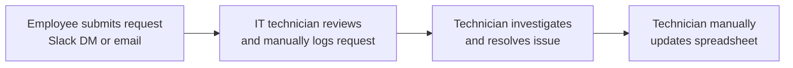
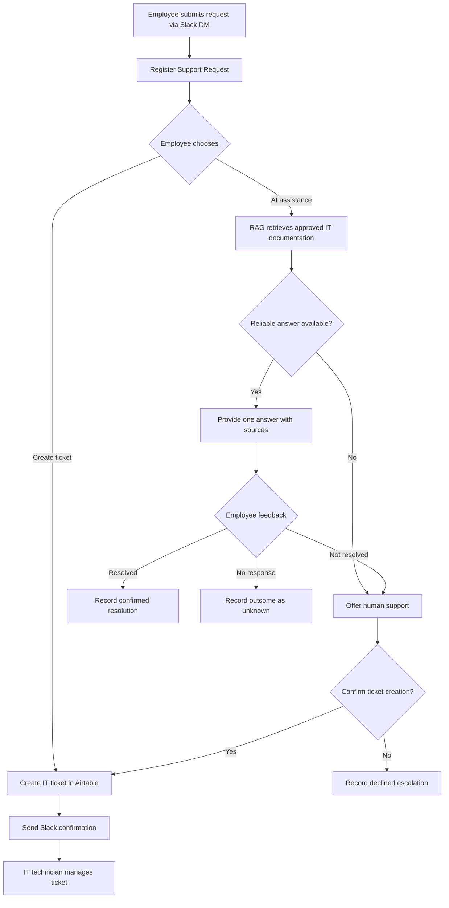

## 1. Business Context & Current State

### Business Context

The client is a fictional company with 150 employees and a three-person internal IT team handling approximately 100 support requests per week. Employees rely on IT support for everyday technical issues, including connectivity, software, and access-related problems.

### Current Workflow (As-Is)

### Operational Pain Points

- **Manual workload:** Technicians manually register requests, update records, and answer recurring questions.
- **Limited traceability:** Requests arriving through separate channels may be missed or inconsistently documented.
- **Limited self-service:** Routine issues depend on technician availability, increasing avoidable support demand.

*The current workflow and identified problems are assumptions for this simulated case study.*

## 2. Objectives & Proposed Solution

### Business Objectives

- **Reduce manual workload:** Automate request registration and routine administrative tasks.
- **Improve traceability:** Centralize support requests and track their status throughout the support process.
- **Enable self-service:** Allow employees to resolve suitable recurring issues using approved IT documentation, while preserving access to human support.

### Future Workflow (To-Be)

The redesigned process combines three responsibilities:

- **Deterministic automation (n8n):** Registers requests, manages routing and feedback, creates tickets, and handles operational failures.
- **Generative AI (RAG):** Retrieves approved IT procedures and generates one source-grounded troubleshooting answer.
- **Human judgment:** Employees decide whether to use AI or request support; IT technicians investigate and resolve escalated issues.

Slack provides the employee interface, while Airtable stores support requests, AI interaction records, tickets, and significant operational events.

### MVP Scope

**In scope**
- Slack-based intake, routing, and automated ticket management.
- One RAG-generated answer per request, with source references.
- Employee feedback, confirmed escalation, and human support.
- Duplicate detection, error handling, and operational logging.
- Offline RAG evaluation using predefined test cases.

**Out of scope**
- Multi-turn AI conversations and autonomous IT actions.
- Continuous RAG quality monitoring.
- Enterprise-scale deployment or a custom frontend.

## 3. Business Requirements

### 3.1 Functional Requirements

| ID | Requirement |
|---|---|
| FR-01 | Employees can submit IT requests through Slack DMs. Each valid request is registered with a unique identifier. |
| FR-02 | Employees can choose between AI troubleshooting and direct ticket creation. |
| FR-03 | The RAG system retrieves approved IT documentation and provides one answer with source references. |
| FR-04 | If no reliable answer is available, the system offers human support without generating unsupported guidance. |
| FR-05 | Employees can confirm resolution or request escalation. Escalated tickets require employee confirmation; missing feedback is recorded as an unknown outcome. |
| FR-06 | Confirmed escalations and direct support requests generate Airtable tickets linked to the original request. |
| FR-07 | Employees receive ticket confirmation through Slack. Technicians can manage ticket statuses in Airtable. |
| FR-08 | The system records AI interactions, retrieval metadata, and significant operational events for traceability. |

### 3.2 Non-Functional Requirements

| ID | Requirement |
|---|---|
| NFR-01 | **Reliability:** Handle integration failures with controlled retries, error logging, alerts, and recovery procedures. A failed Slack confirmation must not create a duplicate ticket. |
| NFR-02 | **Duplicate prevention:** Detect repeated Slack events and minimize duplicate requests and tickets. |
| NFR-03 | **Security & privacy:** Protect credentials, restrict access to support records, and minimize sensitive information stored in logs. |
| NFR-04 | **AI safety:** Restrict responses to approved troubleshooting knowledge and prevent autonomous IT actions or access decisions. |
| NFR-05 | **Traceability:** Link requests, AI sessions, retrieval records, and tickets using consistent identifiers. |
| NFR-06 | **Maintainability:** Use modular workflows and version-controlled IT documentation. |
| NFR-07 | **Performance:** Measure response and ticket confirmation times against targets established during testing. |

## 4. AI Design Considerations

The RAG component supports employee self-service while keeping ticket management and escalation under deterministic workflow rules and human control.

| Area | Design Decision |
|---|---|
| **AI Role** | Retrieve approved internal IT documentation and generate one source-grounded troubleshooting answer. The AI must not modify systems, grant permissions, execute IT actions, or make access decisions. |
| **Evaluation** | Evaluate retrieval offline using Recall@3 and Precision@3 against predefined relevant documents. Assess answer correctness, groundedness, and appropriate escalation using a fixed test dataset. |
| **Failure Modes** | Anticipate irrelevant retrievals, outdated documentation, hallucinated instructions, API failures, and timeouts. Record technical failures and relevant diagnostic metadata; distinguish technical errors from insufficient knowledge. |
| **Guardrails** | Restrict retrieval to approved documents, require source references, validate response structure, and use deterministic rules to control escalation. If evidence is insufficient, the system must not present speculative troubleshooting guidance. |
| **Fallback Strategy** | If AI is unavailable, fails validation, or cannot provide a sufficiently supported answer, offer human support and request confirmation before creating a ticket. Direct ticket creation must remain available independently of AI. |

**MVP boundary:** Basic input validation, treatment of retrieved documents as untrusted content, output validation, and safe escalation are in scope. Offline evaluation will assess retrieval and answer quality. Advanced prompt-injection detection, continuous AI quality monitoring, and automated model-based evaluation are excluded. These remain documented limitations rather than eliminated risks.

## 5. Success Criteria & Evaluation

The MVP will be evaluated through controlled workflow tests, offline RAG evaluation, and simulated business scenarios. Results will demonstrate prototype performance, not validated production outcomes.

| Dimension | KPI | Success Criterion |
|---|---|---|
| **Business efficiency** | Estimated technician time saved | Estimate potential savings using assumed request volumes, handling times, and simulated self-service outcomes. |
| **Self-service effectiveness** | Confirmed resolution rate | Report simulated confirmed resolutions separately from escalations and unknown outcomes. |
| **Ticketing reliability** | Successful ticket creation rate | 100% of valid ticket requests create one ticket in controlled tests. |
| **Duplicate prevention** | Duplicate ticket rate | Zero duplicates in predefined repeated-event tests. |
| **RAG retrieval quality** | Recall@3 and Precision@3 | Meet acceptance thresholds defined before testing, using a fixed dataset of questions and relevant documents. |
| **Answer quality** | Correctness, groundedness, and safety | Meet a predefined evaluation rubric; no unsupported or unsafe instructions in the test set. |
| **Escalation accuracy** | Correct routing rate | 100% of predefined direct-ticket, unresolved, and unsupported-request scenarios follow the expected path. |
| **Operational resilience** | Failure detection and recovery | All predefined failure scenarios produce appropriate logs, alerts, and recovery or safe fallback behavior. |

**Evaluation approach:** Workflow reliability will be tested through functional and failure scenarios. RAG quality will be evaluated offline against versioned test cases and predefined acceptance criteria. Business benefits will be estimated from explicit assumptions, without claiming measured ROI or real employee adoption.

## 6. Assumptions, Risks & Constraints

### Key Assumptions

- A meaningful proportion of IT requests are repetitive and suitable for documentation-based self-service.
- Employees use Slack, and approved internal IT procedures are available for the knowledge base.

### Risks & Mitigations

| Risk | Mitigation |
|---|---|
| Incorrect, outdated, or manipulated AI guidance | Versioned documentation, basic input safeguards, offline evaluation, and human escalation. |
| Integration failures or duplicate tickets | Controlled retries, duplicate checks, error logging, and recovery procedures. |
| Sensitive information exposure | Access controls, data minimization, and secure credential management. |
| Low adoption or unresolved requests | Optional AI assistance, direct ticket access, and explicit feedback tracking. |

### MVP Constraints

- Airtable-based duplicate checks do not guarantee exactly-once ticket creation under concurrent requests.
- The MVP is a portfolio prototype, not a production-ready service.
- Business impact remains hypothetical until validated with real operational data.