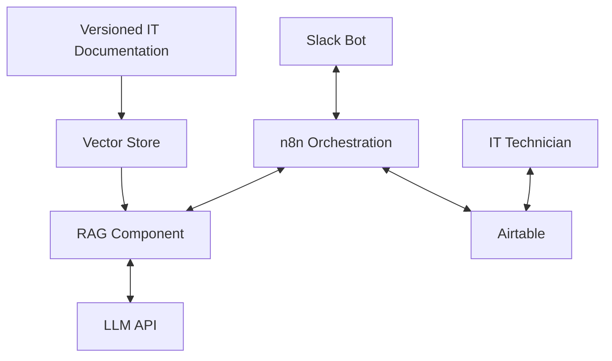
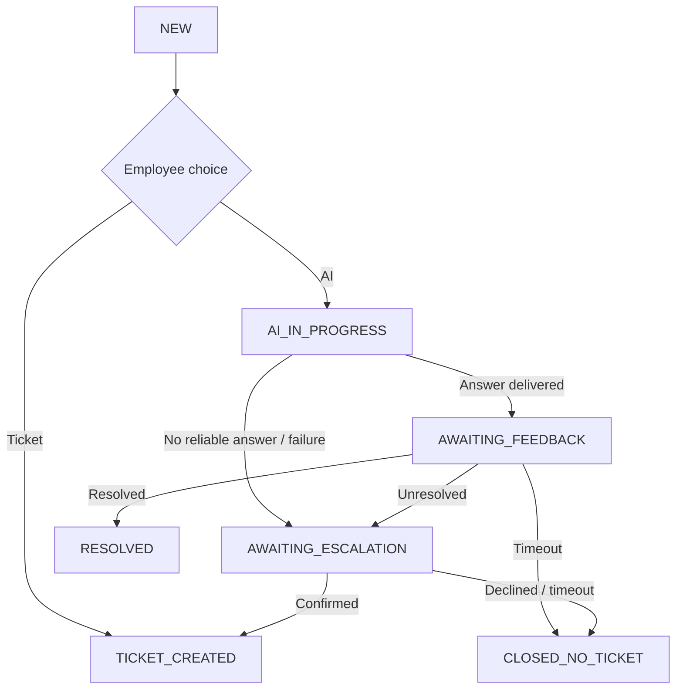
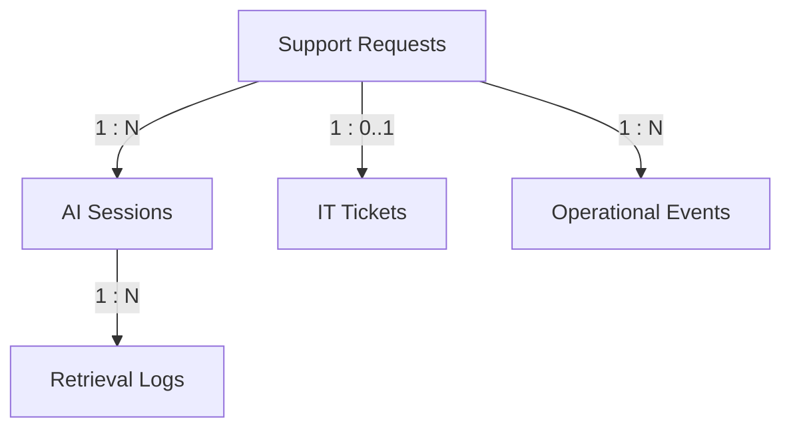
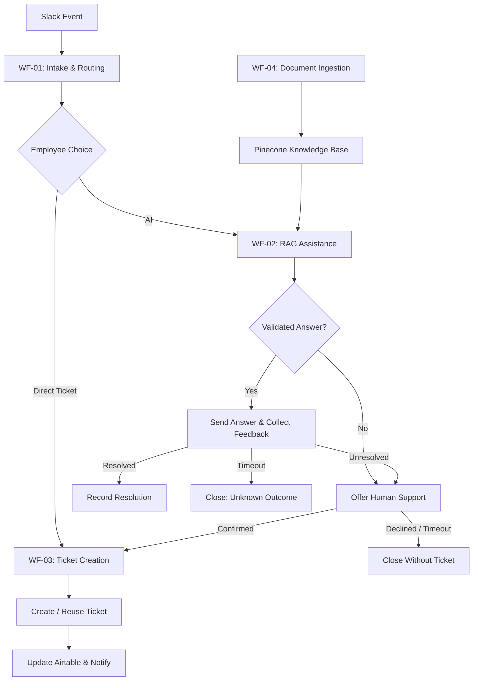
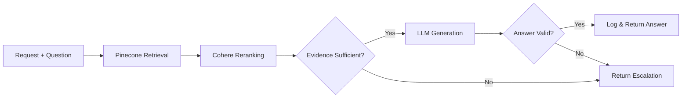
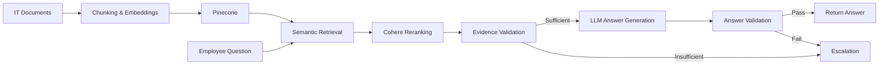

## 2.1 Solution Architecture

### High-Level Architecture

### Component Responsibilities

| Component | Technical Responsibility |
|---|---|
| **Slack** | Message intake, interactive buttons, and notifications. |
| **n8n** | Workflow execution, state transitions, API integrations, retries, and error handling. |
| **Airtable** | Persistent request states, linked records, and ticket management. |
| **RAG Component** | Document retrieval, context preparation, and answer generation. |
| **Vector Store** | Semantic search over versioned IT documentation. |
| **LLM API** | Generate answers from retrieved context. |

### Request Lifecycle

Timeout closures retain an `UNKNOWN` outcome; explicit declines are recorded separately. IT tickets maintain their own statuses.

### Key Design Decisions

- Airtable is the authoritative source for persistent request state.
- n8n validates state transitions and coordinates integrations.
- Stable request identifiers link Slack events, AI sessions, and tickets.
- Ticket creation includes duplicate checks; concurrent processing remains a known limitation.
- Technical failures are recorded separately from business statuses, with recovery procedures for interrupted workflows.

## 2.2 Airtable Data Model

### Tables and Relationships

Airtable contains five linked tables, with **Support Requests** as the central record.

### Table Definitions

| Table | Key Fields | Purpose |
|---|---|---|
| **Support Requests** | `request_id`, `slack_user_id`, `slack_message_ts`, `description`, `status`, `feedback_outcome`, `closure_reason`, `response_deadline`, `created_at`, `updated_at` | Master request record, lifecycle state, and deadline for employee response. |
| **AI Sessions** | `session_id`, `request_id`, `answer`, `sources`, `outcome`, `created_at` | Store AI assistance attempts and outcomes. |
| **Retrieval Logs** | `retrieval_id`, `session_id`, `document_id`, `document_version`, `rank`, `score` | Record retrieved document references for evaluation and debugging. |
| **IT Tickets** | `ticket_id`, `request_id`, `status`, `assigned_to`, `created_at`, `resolved_at` | Track technician-managed support tickets. |
| **Operational Events** | `event_id`, `request_id`, `event_type`, `component`, `error_code`, `timestamp` | Track significant workflow events and failures. |

### Data Integrity Rules

- **Identifiers:** n8n generates stable IDs and preserves Slack event identifiers for correlation.
- **Relationships:** Airtable linked-record fields connect related records. Cardinalities represent application-level rules.
- **Duplicate prevention:** Check Slack identifiers before request creation and `request_id` before ticket creation.
- **State ownership:** n8n updates request statuses; technicians manage ticket statuses.
- **Data minimization:** Exclude credentials and unnecessary sensitive information from stored records and logs.

### Implementation Limitation

Airtable does not enforce unique constraints or transactional writes. Duplicate checks reduce risk but do not guarantee exactly-once creation under concurrent execution.

## 2.3 n8n Workflow Design

### Workflow Structure

The solution uses five modular n8n workflows and shared error handling. Implementation status is tracked in [05_development_checkpoint.md](05_development_checkpoint.md).

| Workflow | Trigger | Main Operations |
|---|---|---|
| **WF-01: Intake & Routing** | Slack message or button interaction | Validate events, register requests, route choices, process feedback, and manage escalation decisions. |
| **WF-02: RAG Assistance** | Called by WF-01 | Retrieve documents from Pinecone, rerank with Cohere, validate evidence, generate one grounded answer, and log results. |
| **WF-03: Ticket Creation** | Called by WF-01 | Check existing tickets, create or reuse Airtable ticket, update request status, and send Slack confirmation. |
| **WF-04: Document Ingestion** | Authorized document upload/update | Load, split, embed, and index versioned IT documentation in Pinecone. |
| **WF-05: Timeout Handling** | Schedule | Close requests whose `response_deadline` expired while awaiting feedback or escalation confirmation. |
| **Error Handling** | Workflow failure | Record errors, send alerts, and flag incomplete operations for recovery. |

### Workflow Interactions

### WF-02: RAG Processing

### Execution Rules

- **Correlation:** Propagate `request_id` across workflows and Slack interactions.
- **State management:** Validate Airtable request status before transitions.
- **Duplicate prevention:** Check existing requests and tickets before creation.
- **RAG output:** Return structured outcomes, source references, and retrieval metadata.
- **Failure handling:** Apply controlled retries, log errors, and preserve recoverable request state.
- **Notifications:** Retry failed Slack confirmations independently of ticket creation.

## 2.4 RAG Technical Design

### Processing Pipeline

### Technical Configuration

| Component | Design Decision |
|---|---|
| **Knowledge Base** | Approved IT procedures with document IDs and versions. |
| **Chunking** | Recursive text splitting; chunk size and overlap determined through testing. |
| **Embeddings** | OpenAI embedding model for indexing and query representation. |
| **Retrieval** | Pinecone semantic search, followed by Cohere reranking. |
| **Generation** | OpenAI LLM produces one answer using retrieved context and source references. |
| **Validation** | Check evidence availability, source references, and output structure; escalate when validation fails. |
| **Logging** | Record document IDs, versions, retrieval ranks, scores, and AI outcomes. |

### Evaluation

Use a fixed, versioned test dataset to measure Recall@3, Precision@3, answer correctness, groundedness, and escalation accuracy. Establish acceptance thresholds before testing.

## 2.5 Reliability & Operations

### Operational Controls

| Area | Implementation |
|---|---|
| **Idempotency** | Use stable Slack event identifiers and `request_id` to detect repeated events and ticket requests. |
| **Retries** | Retry transient API failures with bounded attempts and backoff. |
| **State Recovery** | Check Airtable records before resuming interrupted workflows. |
| **Error Handling** | Use n8n error workflows and Airtable Operational Events to capture failures. |
| **Alerts** | Notify the IT administrator of failed executions requiring intervention. |
| **Monitoring** | Track execution failures, ticket creation outcomes, processing latency, and unresolved recovery cases. |
| **Security** | Store API credentials in n8n, restrict Airtable access, and avoid sensitive data in logs. |

### Failure Scenarios

| Failure | Recovery |
|---|---|
| RAG API unavailable | Offer human support. |
| Airtable write fails | Retry safely; verify record existence before another creation attempt. |
| Slack confirmation fails | Retry notification without recreating the ticket. |
| Workflow interrupted | Reconcile persisted state and resume or flag for manual recovery. |
| Pinecone unavailable | Bypass AI assistance and offer escalation. |

**Operational limitation:** Airtable does not provide transactional uniqueness guarantees. Concurrent duplicate creation remains a residual risk.