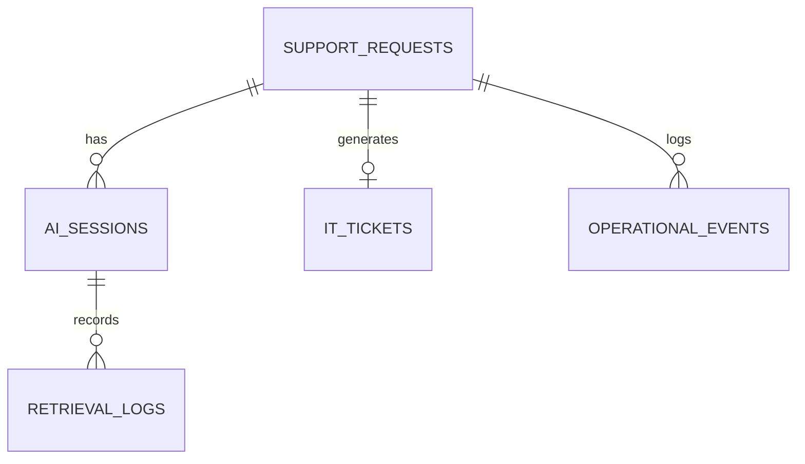

## 2.2 Airtable Data Model

### Tables and Relationships

Airtable contains five linked tables, with **Support Requests** as the central record.

### Table Definitions

**1. Support Requests**

| Field | Airtable Type |
|---|---|
| `request_id` | Single line text (Primary) |
| `slack_user_id` | Single line text |
| `slack_message_ts` | Single line text |
| `description` | Long text |
| `status` | Single select |
| `feedback_outcome` | Single select |
| `closure_reason` | Single select |
| `response_deadline` | Date (with time) |
| `created_at` | Created time |
| `updated_at` | Last modified time |

**2. AI Sessions**

| Field | Airtable Type |
|---|---|
| `session_id` | Single line text (Primary) |
| `request_id` | Link to Support Requests |
| `answer` | Long text |
| `sources` | Long text |
| `outcome` | Single select |
| `created_at` | Created time |

**3. Retrieval Logs**

| Field | Airtable Type |
|---|---|
| `retrieval_id` | Single line text (Primary) |
| `session_id` | Link to AI Sessions |
| `document_id` | Single line text |
| `document_version` | Single line text |
| `rank` | Number (integer) |
| `score` | Number (decimal) |

**4. IT Tickets**

| Field | Airtable Type |
|---|---|
| `ticket_id` | Single line text (Primary) |
| `request_id` | Link to Support Requests |
| `status` | Single select |
| `assigned_to` | Single line text |
| `created_at` | Created time |
| `resolved_at` | Date (with time) |

**5. Operational Events**

| Field | Airtable Type |
|---|---|
| `event_id` | Single line text (Primary) |
| `request_id` | Link to Support Requests |
| `event_type` | Single select |
| `component` | Single select |
| `error_code` | Single line text |
| `timestamp` | Created time |

### Single-Select Values

Implemented in Airtable; the n8n workflows depend on these exact values.

| Table | Field | Values |
|---|---|---|
| Support Requests | `status` | `NEW`, `AI_IN_PROGRESS`, `AWAITING_FEEDBACK`, `AWAITING_ESCALATION`, `TICKET_CREATED`, `RESOLVED`, `CLOSED_NO_TICKET` |
| Support Requests | `feedback_outcome` | `RESOLVED`, `UNRESOLVED`, `UNKNOWN` |
| Support Requests | `closure_reason` | `RESOLVED`, `TIMEOUT`, `ESCALATION_DECLINED`, `TICKET_CREATED` |
| AI Sessions | `outcome` | `ANSWERED`, `NO_RELIABLE_ANSWER`, `FAILED` |
| IT Tickets | `status` | `OPEN`, `IN_PROGRESS`, `RESOLVED`, `CLOSED` |
| Operational Events | `event_type` | `REQUEST_CREATED`, `AI_ANSWER_DELIVERED`, `FEEDBACK_RECEIVED`, `ESCALATION_CONFIRMED`, `TICKET_CREATED`, `TIMEOUT_CLOSED`, `WORKFLOW_ERROR` |
| Operational Events | `component` | `SLACK`, `N8N`, `RAG`, `AIRTABLE` |

### Identifiers

- `request_id` = `REQ-<slack_user_id>-<message_ts>` (deterministic, so a replayed Slack event resolves to the same request).
- `ticket_id` = `TKT-<request_id>`.
- `event_id` = `EVT-<request_id>-<epoch_ms>`.

### Data Integrity Rules

- **Identifiers:** n8n generates stable IDs and preserves Slack event identifiers for correlation.
- **Relationships:** Airtable linked-record fields connect related records.
- **Duplicate prevention:** Check Slack identifiers before request creation and `request_id` before ticket creation.
- **State ownership:** n8n updates request statuses; technicians manage ticket statuses.
- **Data minimization:** Exclude credentials and unnecessary sensitive information from stored records and logs.

### Implementation Limitation

Airtable does not enforce unique constraints or transactional writes. Duplicate checks reduce risk but do not guarantee exactly-once creation under concurrent execution.